*English* · [Русский](README.ru.md)

<div align="center">

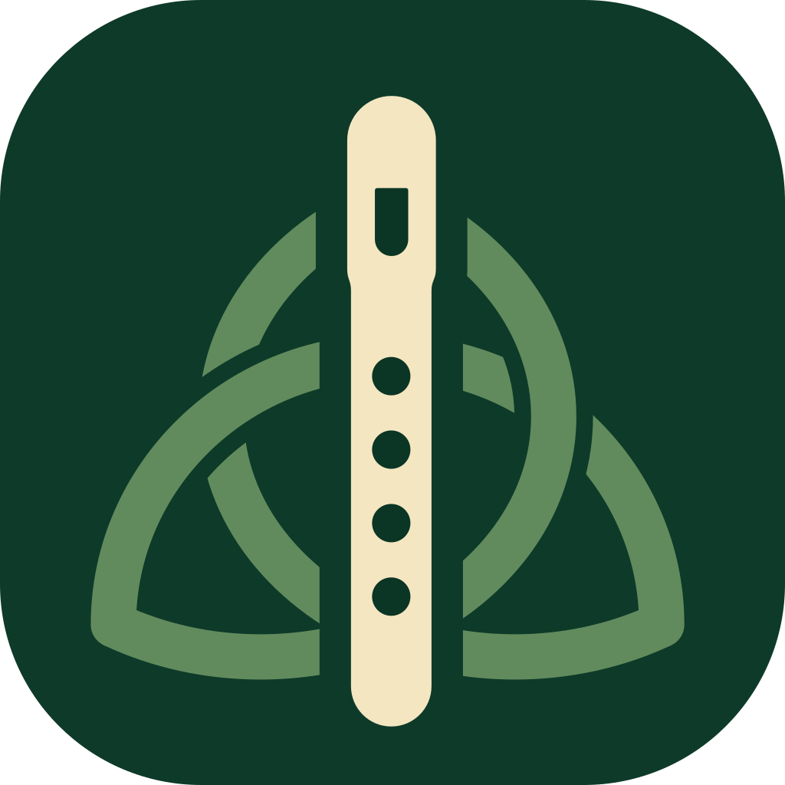

# Tin Whistler

**Learn the tin whistle with real tunes, live microphone feedback and tabs you can edit.**

A course, a tuner, trainers and games, and a tune library you learn section by section.
Runs in the browser or as an Android app. Your progress stays on your device.

<p>
  
  
  
  
  
  
  <a href="LICENSE"></a>
</p>

<br />

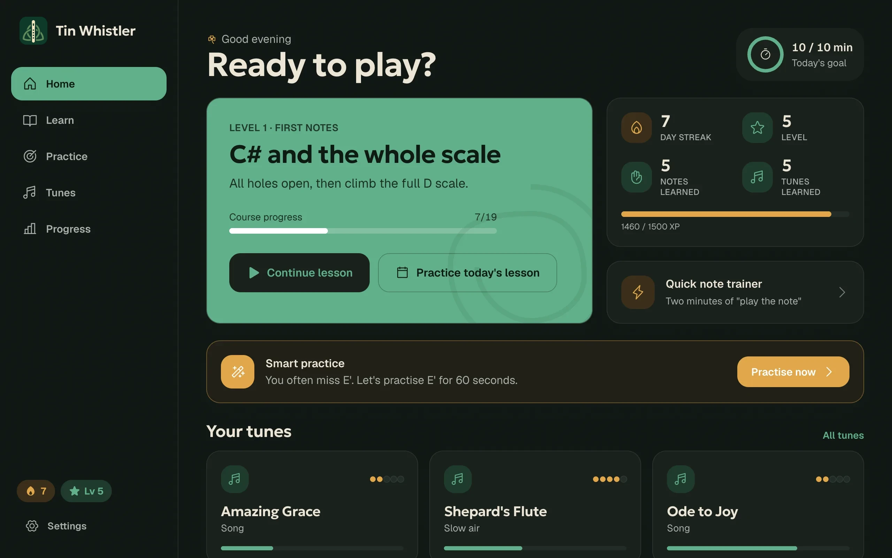

</div>

## A quick tour

<table>
  <tr>
    <td width="50%">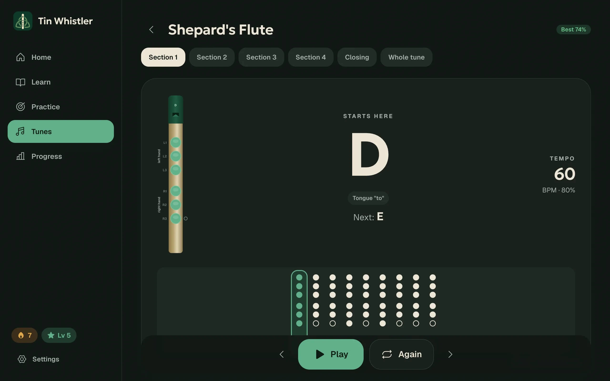</td>
    <td width="50%">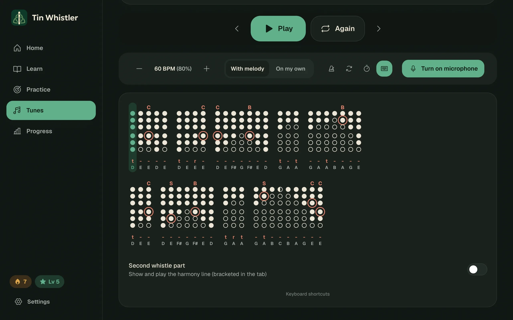</td>
  </tr>
  <tr>
    <td><b>Play along.</b> A big "now / next" stage you can read from a music stand, with the fingering for every note. Loop a section, slow it down, add a count-in, or turn the guide melody off and play on your own.</td>
    <td><b>Real whistle tabs.</b> Cuts, bounces, slides, rolls and trills; tongued, "ru" and slurred notes; sharp stops and half-holes, the way whistle players write them.</td>
  </tr>
  <tr>
    <td>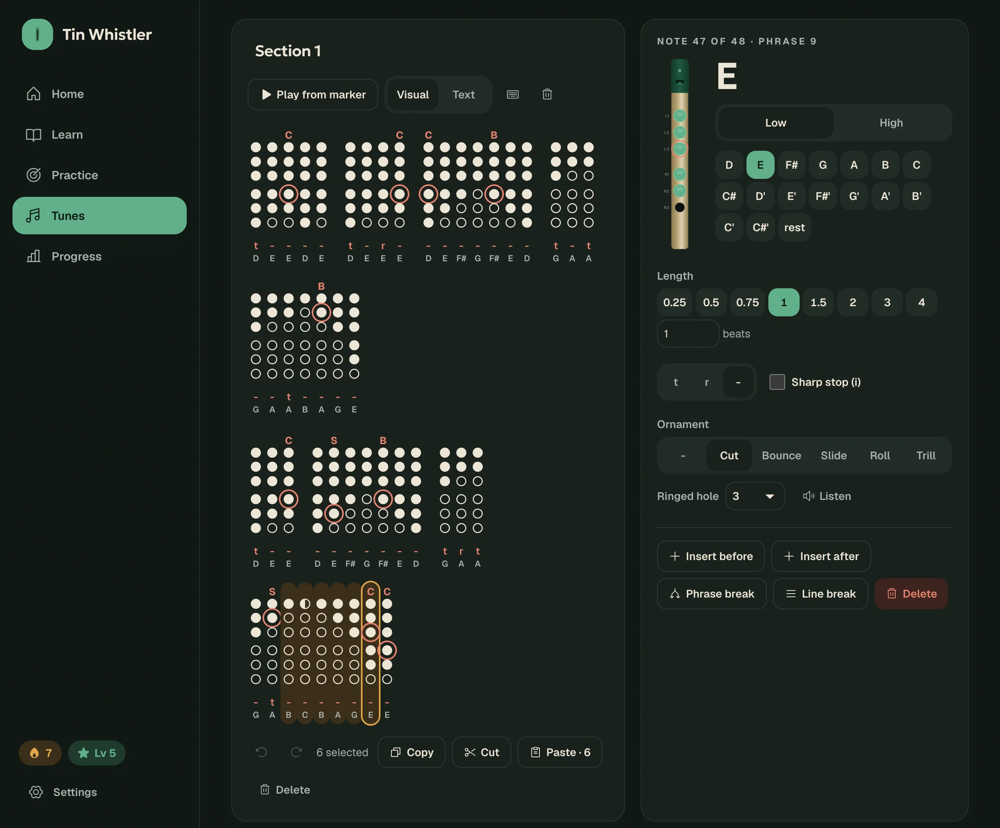</td>
    <td>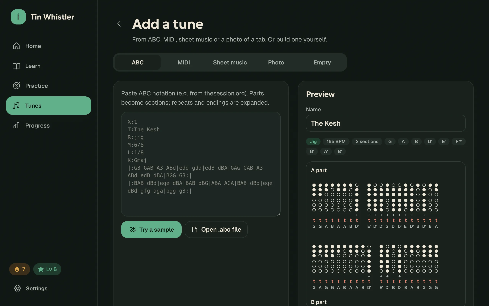</td>
  </tr>
  <tr>
    <td><b>Edit anything, from the keyboard too.</b> Type a tune like text: <code>D</code>–<code>C</code> for notes, <code>Shift</code> for the upper octave, digits for length, <code>T R - I</code> for articulation, <code>Alt</code> + letter for ornaments (a built-in guide lists them all). Select columns to copy, cut, paste or drag them (phrase breaks come along). Undo and redo, any whistle key, and a text mode are there too.</td>
    <td><b>Bring your own tunes.</b> ABC from thesession.org, MIDI, sheet music (SVG or JPG/PNG) and photos of dot tabs, dark-theme screenshots included. Import a whole tune or add a section to one you already have.</td>
  </tr>
  <tr>
    <td>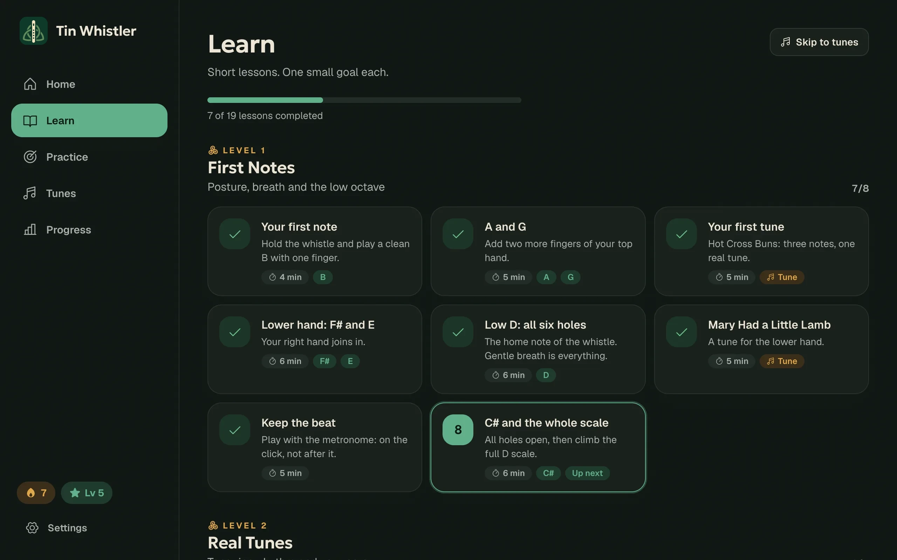</td>
    <td>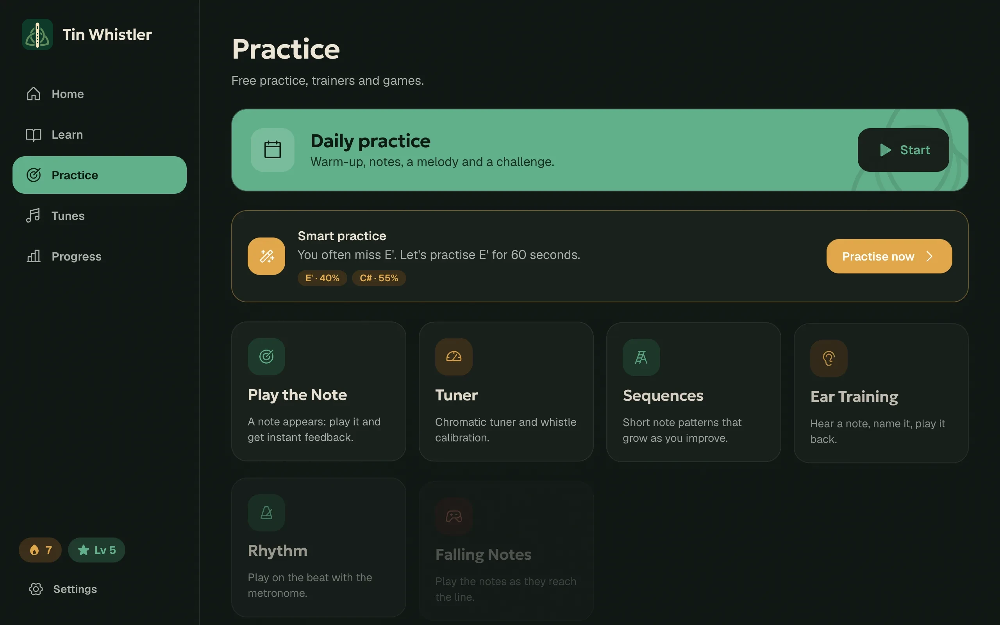</td>
  </tr>
  <tr>
    <td><b>A course that starts from zero.</b> 4 levels and 19 short lessons, from the first B to the second octave and ornaments. Each lesson has one goal.</td>
    <td><b>Trainers and games.</b> Play the Note, Sequences, Ear Training, Rhythm, a chromatic Tuner, Falling Notes, Free Practice with a recorder, and a Fingering Explorer.</td>
  </tr>
  <tr>
    <td>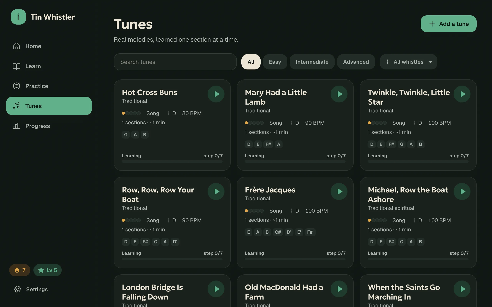</td>
    <td>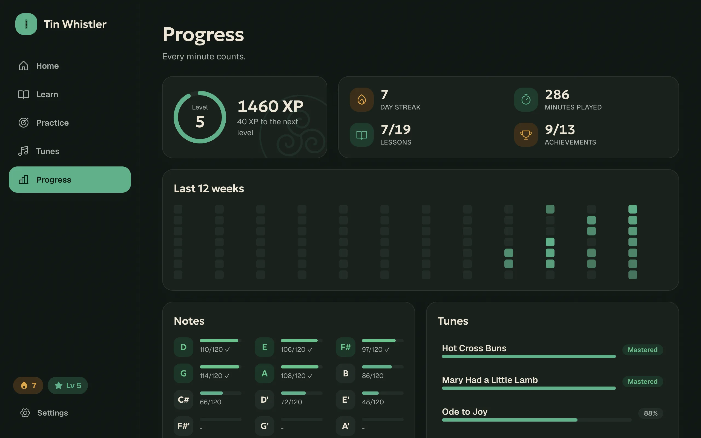</td>
  </tr>
  <tr>
    <td><b>33 built-in tunes.</b> Search them, filter by difficulty or whistle key, and preview any tune right from its card.</td>
    <td><b>See yourself improve.</b> XP and levels, streaks, a 12-week calendar, mastery for every note, and Smart Practice, which drills the note you miss most.</td>
  </tr>
</table>

### On your phone

<p align="center">
  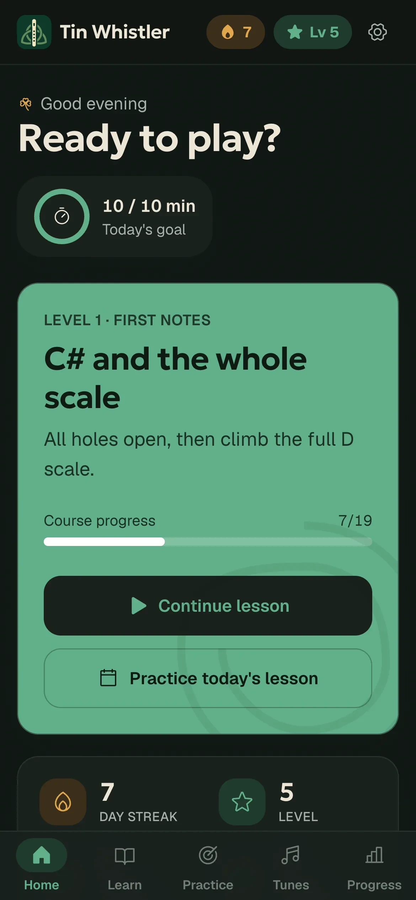
  &nbsp;
  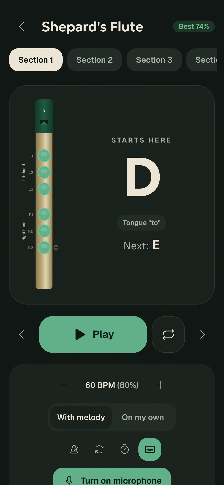
  &nbsp;
  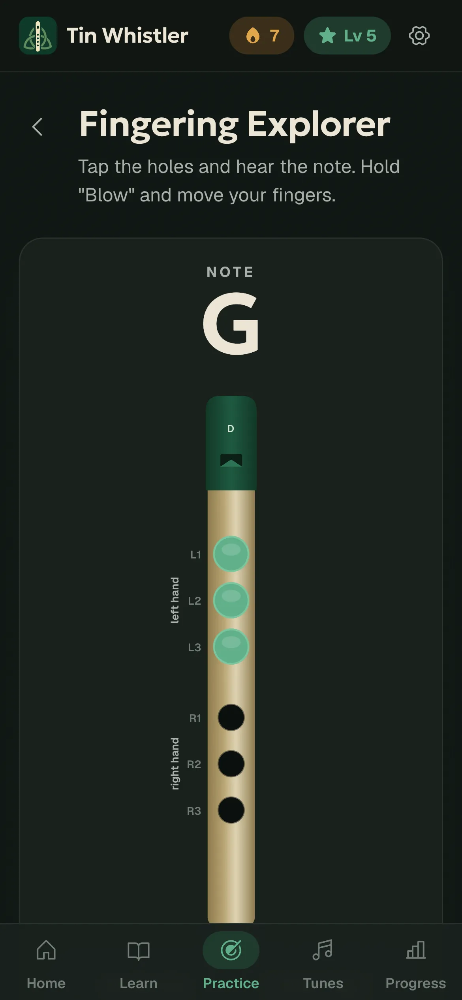
</p>

## Features

- **Pitch detection**: YIN runs in a Web Worker and is fed by an AudioWorklet. An adaptive noise gate filters out cuts and taps, and a pitch jump has to hold across frames (so octave glitches don't count). Calibration covers A4 and your whistle's own tuning.
- **Scoring**: Notes, Rhythm, Timing and Overall scores, plus the wrong notes, where you lost your place and which phrases to repeat (looping them takes one click).
- **Synth voice**: a breathy whistle voice with tonguing, "ru", slurs and every ornament. A trill flicks at a fixed fast rate, so a longer note gets more flicks.
- **Any whistle**: low D, D, C, B♭ and G whistles. Fingerings are stored relative to the tonic.
- **Onboarding**: how to hold the whistle, breath and fingers, then your level, a daily goal and the microphone.
- **Progress**: daily goal, a 10-minute Daily Practice, achievements and tune progress.
- **UI**: EN/RU, light and dark themes, reduced motion, keyboard shortcuts, screen-reader labels, and states that never rely on colour alone.

## Run it

```bash
npm install
npm run dev        # http://localhost:5173
npm test           # vitest: pitch detection, scoring, notation, tab recognition, editing
npm run build      # typecheck + production bundle
```

The microphone needs a secure context: `localhost` or HTTPS.

### Android

The Android app is a [Capacitor](https://capacitorjs.com) shell around the same build (`android/`, app id `io.github.spacecadet0.tinwhistler`). It needs Android 7.0 or newer.

```bash
npm run build && npx cap sync android
cd android && ./gradlew assembleRelease   # → app/build/outputs/apk/release/app-release.apk
```

You need the Android SDK and JDK 21, both of which ship with Android Studio. The release build is signed with the local debug key, so the APK can be installed directly (allow installs from unknown sources). Use your own upload key before publishing to a store.

## Architecture

```
src/
  music/        pure music model: types, pitch math, fingering chart (any whistle key),
                whistle notes, scales, tab-text notation, tune flattening/sectioning, ornaments, editing ops
  audio/        AudioEngine (context), WhistleSynth (voice + ornaments), Metronome, TunePlayer
                (look-ahead scheduler), MicInput (worklet → worker), PitchTracker, Recorder
    pitch/      yin.ts (detector), pitch.worker.ts, captureWorklet.ts, stabilizer.ts
  engine/       application logic, UI-free
    scoring/    note matching, hold tracker, segmenter, performance & rhythm scoring
    lesson/     lesson/exercise types, course progression
    progress/   XP curve, streaks, achievements
    adaptive/   smart practice, adaptive difficulty
    daily.ts    daily plan
  import/       ABC parser, MIDI import, sheet-music SVG reader (notationSvg + svgPath), tab-image recognition (+ worker), whistle-range fitting
  data/         lessons (course.ts) and built-in tunes: data only, no UI
  state/        zustand stores: settings, progress (persisted), tune library (IndexedDB repository)
  i18n/         typed dictionaries (en is the source of truth; ru must cover every key)
  ui/           design system primitives, icons, whistle visuals (WhistleView, FingeringColumn, TabView), feedback widgets
  features/     screens: onboarding, home, learn, exercises, practice, daily, tunes (+ editor), progress, settings
  hooks/        usePitch, usePlayer, useNoteHold, useHotkeys, …
```

- **Storage boundary**: `lib/storage.ts` (key/value adapter for the stores) and `state/tunes.ts → TuneRepository`. Swap these for an API to add accounts and sync; no component changes.
- **New whistle keys**: fingerings are stored as offsets from the tonic, so a new entry in `WHISTLE_KEYS` is enough.

### Adding a lesson

Append an object to `LESSONS` in `src/data/lessons/course.ts`. Each exercise is typed (`info`, `fingering`, `note`, `pitch`, `listening`, `rhythm`, `sequence`, `melody`, `free-play`). `ExerciseRunner` renders any of them, so adding a lesson needs no UI work.

### Adding a tune

Built-in tunes use a compact tab notation (`src/music/tabText.ts`):

```
t:D*0.5 -:E^C4*0.25 | r:A+! -:C[h00000]
```

| Token | Meaning |
|---|---|
| `t:` | tongue |
| `r:` | "ru" |
| `-:` | slur |
| `+` | second octave |
| `!` | sharp stop ("i") |
| `^C4` | cut with a ring on hole 4 (`B` bounce, `S` slide, `R` roll, `T` trill; `~3` sets the slide span) |
| `[h00000]` | explicit fingering (`1` covered, `0` open, `h` half) |
| `*0.5` | length in beats |
| `\|` | new phrase |
| `/` | new line |

Users can also import ABC, MIDI or images, or build a tune in the editor.

## Notes and limitations

- Sheet music is read exactly from **SVG exports** (MuseScore: File → Export → SVG, one file per page). JPG/PNG scores are recognised for pitch only: every note gets the same length, so fix the rhythm in the editor. Tempo text isn't read, so set the BPM after importing.

- *Shepard's Flute* is Bill Brown's Lineage II theme, transcribed from the tab screenshots in `reference/` (tab by Hound4Sound). It is bundled for personal practice. Remove it before distributing the app.
- Tab-image recognition targets dot-style whistle tabs on white or tinted paper, photo backgrounds and dark themes, including dots drawn edge to edge. Note names written under the columns are ignored (only `t`, `r`, `-` and `i` are read as articulation), and the octave comes from the `+` marks. On the reference screenshots it gets pitch classes ≥ 97% right. The "+" octave marks are less reliable on photographic backgrounds, and bracketed second voices are imported as extra phrases. Fix these in the editor.
- Ornaments are displayed, synthesised and taught, but not graded. Cuts and taps are too short to judge reliably from a phone microphone, so scoring ignores them on purpose.

## License

[MIT](LICENSE) © Igor Rusakov (SpaceCadet)
