[English](README.md) · *Русский*

<div align="center">


# Tin Whistler

**Учитесь играть на вистле по настоящим мелодиям, с подсказками от микрофона в реальном времени и табами, которые можно редактировать.**

Курс, тюнер, тренажёры и игры, а ещё библиотека мелодий, которые разучиваются по частям.
Работает в браузере и как Android-приложение. Прогресс хранится только на вашем устройстве.

<p>
  
  
  
  
  
  
  <a href="LICENSE"></a>
</p>

<br />

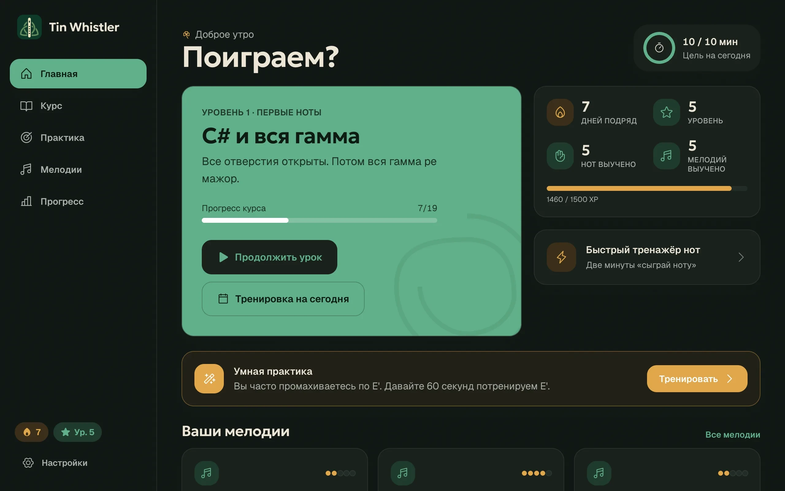

</div>

## Коротко о главном

<table>
  <tr>
    <td width="50%">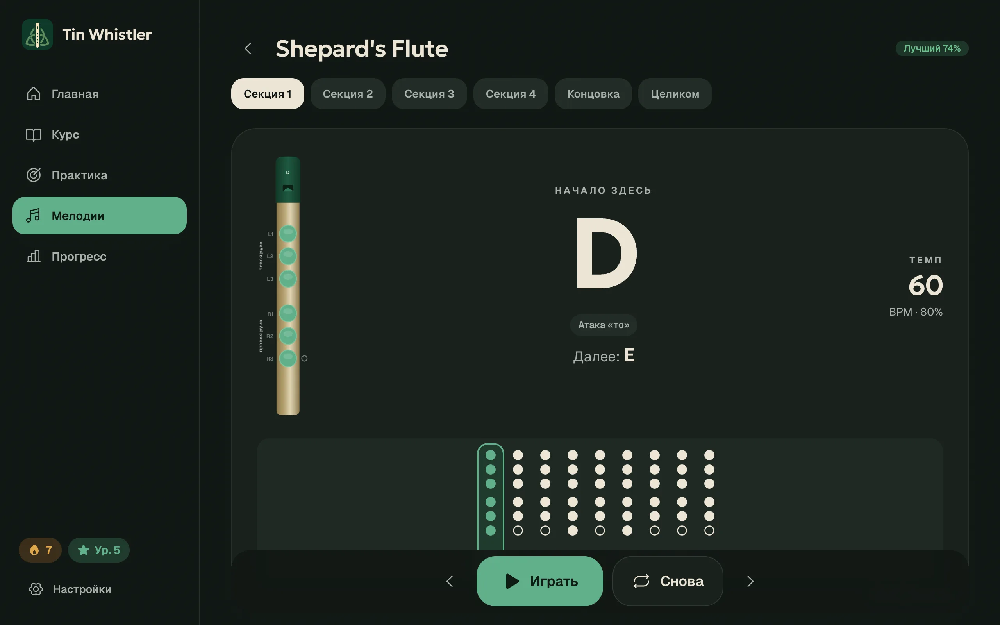</td>
    <td width="50%">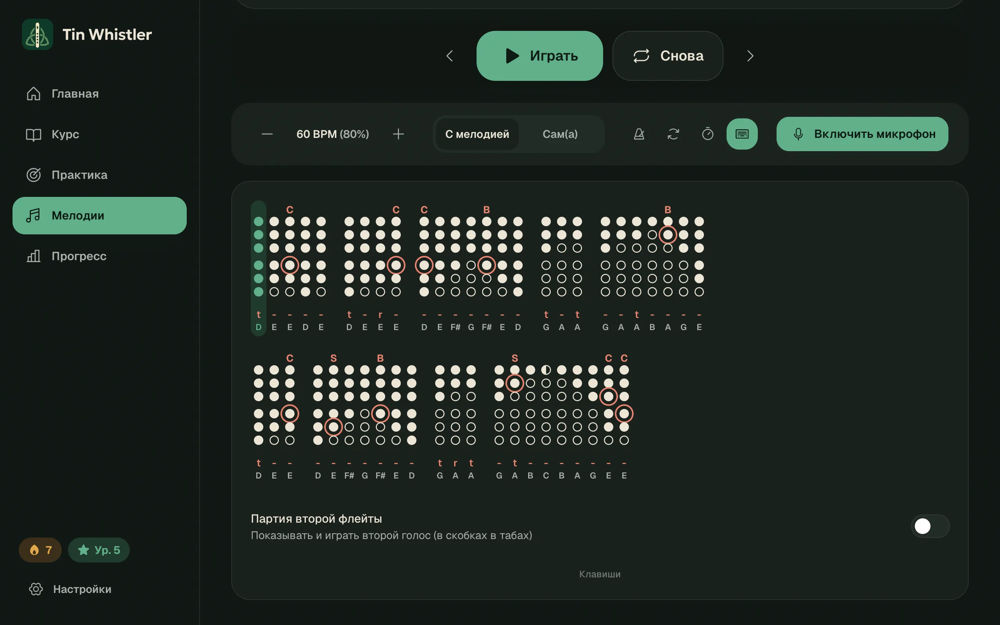</td>
  </tr>
  <tr>
    <td><b>Играйте вместе с приложением.</b> Крупная сцена «сейчас / дальше», которую видно с пюпитра, и аппликатура для каждой ноты. Зацикливайте часть мелодии, замедляйте темп, включайте отсчёт или выключайте подсказывающую мелодию и играйте сами.</td>
    <td><b>Настоящие табы для вистла.</b> Каты, тапы, слайды, роллы и трели; ноты с атакой «то», «ру» и легато; резкая остановка и полузакрытые отверстия, как их записывают сами вистлеры.</td>
  </tr>
  <tr>
    <td>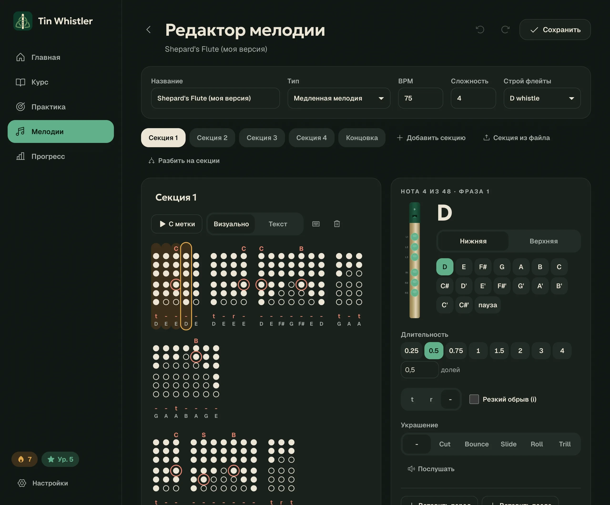</td>
    <td>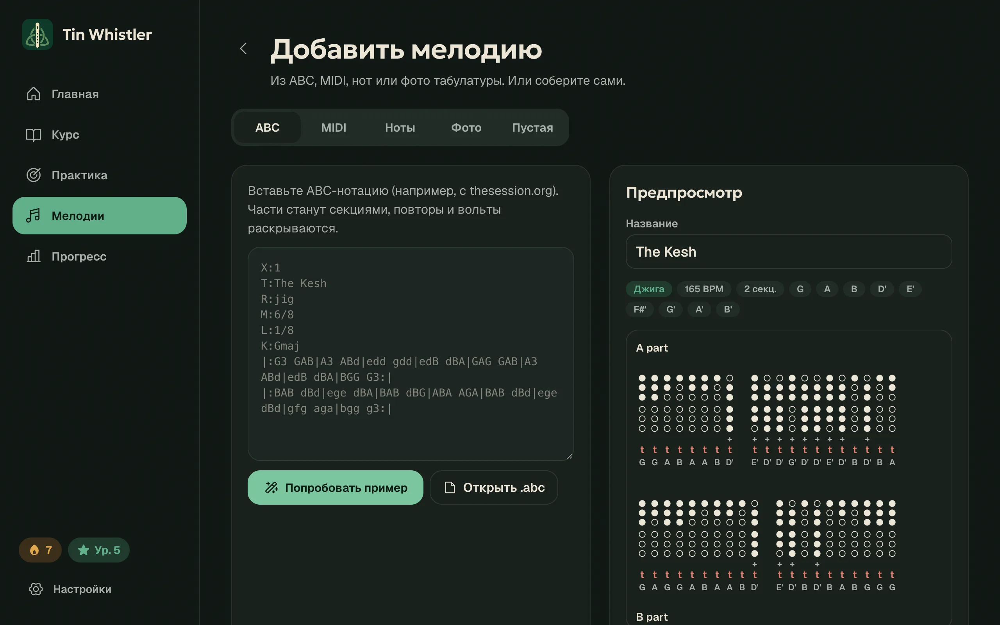</td>
  </tr>
  <tr>
    <td><b>Редактируйте что угодно, в том числе с клавиатуры.</b> Набирайте мелодию как текст: <code>D</code>–<code>C</code> для нот, <code>Shift</code> для верхней октавы, цифры для длительности, <code>T R - I</code> для артикуляции, <code>Alt</code> + буква для украшений (встроенная подсказка перечисляет все клавиши). Выделяйте колонки, чтобы копировать, вырезать, вставлять или перетаскивать их (разрывы фраз переносятся вместе с ними). Есть отмена и повтор, любой строй вистла и текстовый режим.</td>
    <td><b>Добавляйте свои мелодии.</b> ABC с thesession.org, MIDI, ноты (SVG или JPG/PNG) и фотографии точечных табов, в том числе скриншоты в тёмной теме. Импортируйте мелодию целиком или добавьте новую часть к уже существующей.</td>
  </tr>
  <tr>
    <td>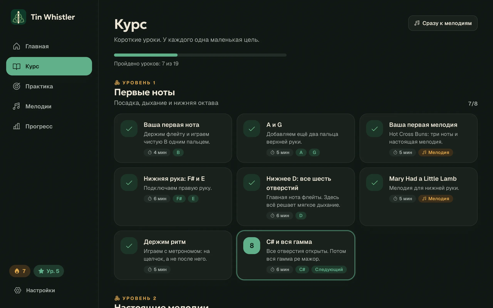</td>
    <td>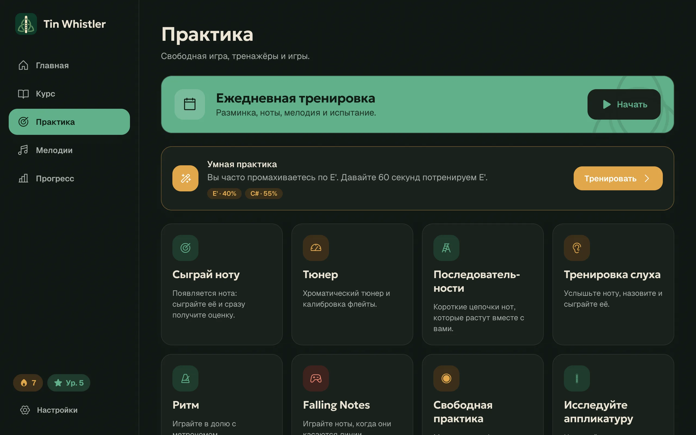</td>
  </tr>
  <tr>
    <td><b>Курс с нуля.</b> 4 уровня и 19 коротких уроков: от первой ноты B до второй октавы и украшений. У каждого урока одна цель.</td>
    <td><b>Тренажёры и игры.</b> «Сыграй ноту», «Последовательности», тренировка слуха, ритм, хроматический тюнер, «Падающие ноты», свободная игра с записью и справочник аппликатур.</td>
  </tr>
  <tr>
    <td>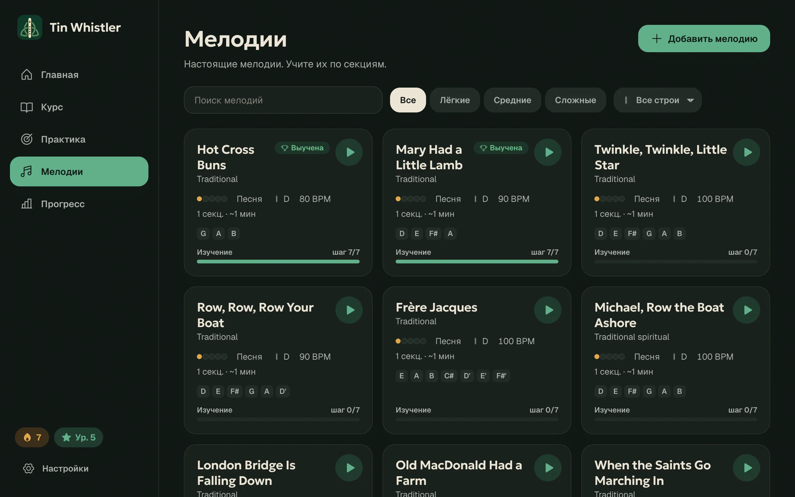</td>
    <td>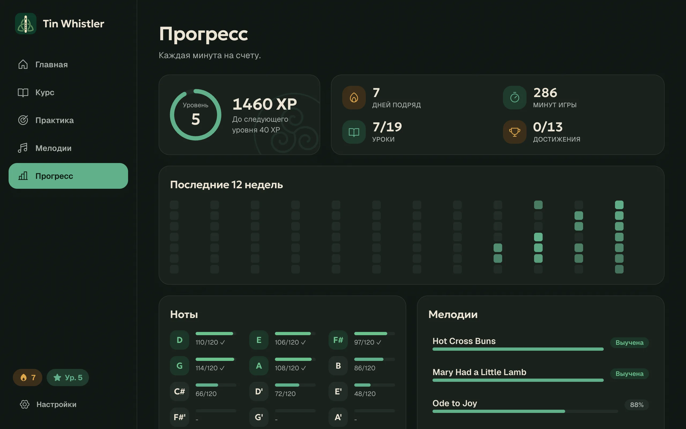</td>
  </tr>
  <tr>
    <td><b>77 встроенных мелодий.</b> Ищите их, фильтруйте по сложности или строю вистла и слушайте любую прямо с карточки.</td>
    <td><b>Видно, как вы растёте.</b> Очки опыта и уровни, серии дней, календарь за 12 недель, освоение каждой ноты и умная практика, которая тренирует ноту, на которой вы чаще всего ошибаетесь.</td>
  </tr>
</table>

### На телефоне

<p align="center">
  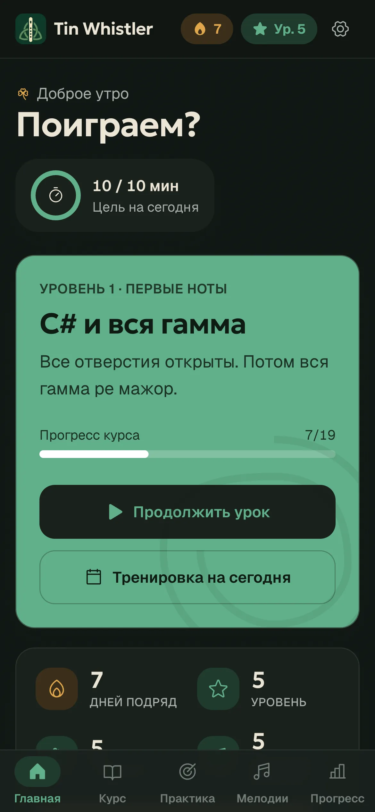
  &nbsp;
  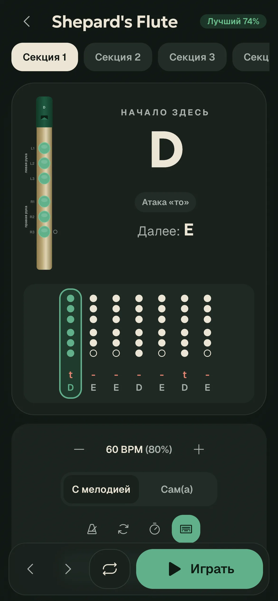
  &nbsp;
  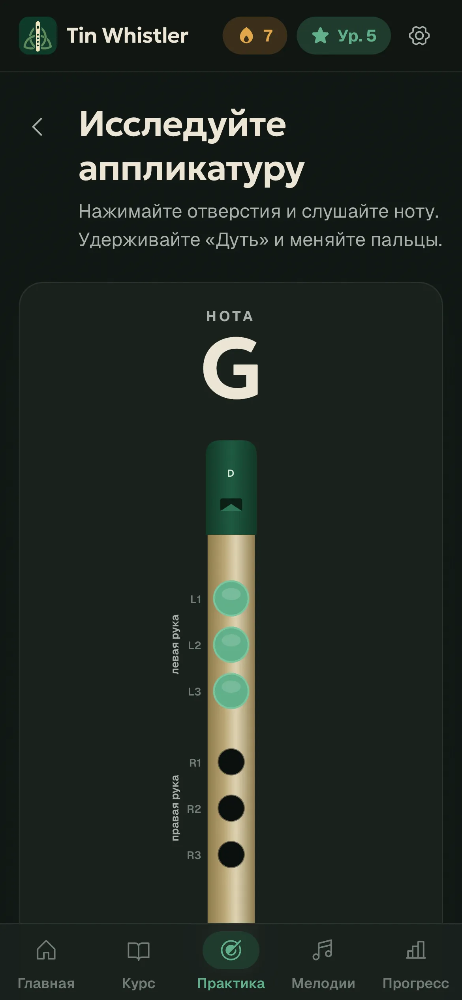
</p>

## Возможности

- **Определение высоты звука**: алгоритм YIN работает в Web Worker и получает звук из AudioWorklet. Адаптивный шумовой порог отсекает каты и тапы, а скачок высоты засчитывается, только если держится несколько кадров (поэтому случайные октавные срывы не считаются). Калибровка учитывает A4 и строй вашего вистла.
- **Оценка игры**: баллы за ноты, ритм, попадание в долю и общий результат, а ещё список неверных нот, мест, где вы сбились, и фраз, которые стоит повторить (зациклить их можно одним нажатием).
- **Синтезированный голос**: дыхательный тембр вистла с атакой, «ру», легато и всеми украшениями. Трель звучит с фиксированной быстрой частотой, поэтому на длинной ноте больше колебаний.
- **Любой вистл**: low D, D, C, B♭ и G. Аппликатуры хранятся относительно тоники.
- **Знакомство**: как держать вистл, дыхание и пальцы, затем выбор уровня, дневной цели и настройка микрофона.
- **Прогресс**: дневная цель, 10-минутная ежедневная практика, достижения и прогресс по мелодиям.
- **Интерфейс**: английский и русский, светлая и тёмная темы, уменьшение анимации, горячие клавиши, подписи для экранных чтецов и состояния, которые никогда не передаются только цветом.

## Запуск

```bash
npm install
npm run dev        # http://localhost:5173
npm test           # vitest: высота звука, оценка, нотация, распознавание табов, редактирование
npm run build      # проверка типов + production-сборка
```

Для микрофона нужен защищённый контекст: `localhost` или HTTPS.

### Android

Android-приложение — это оболочка [Capacitor](https://capacitorjs.com) вокруг той же сборки (`android/`, app id `io.github.spacecadet0.tinwhistler`). Нужен Android 7.0 или новее.

```bash
npm run build && npx cap sync android
cd android && ./gradlew assembleRelease   # → app/build/outputs/apk/release/app-release.apk
```

Понадобятся Android SDK и JDK 21, оба идут вместе с Android Studio. Релизная сборка подписана локальным debug-ключом, поэтому APK можно установить напрямую (разрешите установку из неизвестных источников). Перед публикацией в магазине используйте собственный ключ.

## Архитектура

```
src/
  music/        чистая музыкальная модель: типы, расчёт высоты, таблица аппликатур (любой строй),
                ноты вистла, гаммы, текстовая нотация табов, развёртка и деление мелодий, украшения, операции редактирования
  audio/        AudioEngine (контекст), WhistleSynth (голос + украшения), Metronome, TunePlayer
                (планировщик с упреждением), MicInput (worklet → worker), PitchTracker, Recorder
    pitch/      yin.ts (детектор), pitch.worker.ts, captureWorklet.ts, stabilizer.ts
  engine/       логика приложения без UI
    scoring/    сопоставление нот, удержание, сегментация, оценка исполнения и ритма
    lesson/     типы уроков и упражнений, продвижение по курсу
    progress/   кривая опыта, серии, достижения
    adaptive/   умная практика, адаптивная сложность
    daily.ts    план на день
  import/       парсер ABC, импорт MIDI, чтение нот из SVG (notationSvg + svgPath), распознавание табов по картинке (+ worker), подгонка под диапазон вистла
  data/         уроки (course.ts) и встроенные мелодии: только данные, без UI
  state/        zustand-хранилища: настройки, прогресс (сохраняются), библиотека мелодий (репозиторий в IndexedDB)
  i18n/         типизированные словари (en — эталон; ru должен покрывать все ключи)
  ui/           базовые компоненты дизайн-системы, иконки, визуализация вистла (WhistleView, FingeringColumn, TabView), виджеты обратной связи
  features/     экраны: знакомство, главная, курс, упражнения, практика, ежедневная практика, мелодии (+ редактор), прогресс, настройки
  hooks/        usePitch, usePlayer, useNoteHold, useHotkeys, …
```

- **Граница хранения**: `lib/storage.ts` (адаптер ключ/значение для хранилищ) и `state/tunes.ts → TuneRepository`. Замените их на API, чтобы добавить аккаунты и синхронизацию; компоненты менять не придётся.
- **Новые строи вистла**: аппликатуры хранятся как смещения от тоники, поэтому достаточно новой записи в `WHISTLE_KEYS`.

### Как добавить урок

Добавьте объект в `LESSONS` в `src/data/lessons/course.ts`. Каждое упражнение типизировано (`info`, `fingering`, `note`, `pitch`, `listening`, `rhythm`, `sequence`, `melody`, `free-play`). `ExerciseRunner` умеет показывать любое из них, так что новый урок не требует работы над интерфейсом.

### Как добавить мелодию

Встроенные мелодии записываются компактной нотацией табов (`src/music/tabText.ts`):

```
t:D*0.5 -:E^C4*0.25 | r:A+! -:C[h00000]
```

| Токен | Значение |
|---|---|
| `t:` | атака языком |
| `r:` | «ру» |
| `-:` | легато |
| `+` | вторая октава |
| `!` | резкая остановка («i») |
| `^C4` | кат с кольцом на 4-м отверстии (`B` тап, `S` слайд, `R` ролл, `T` трель; `~3` задаёт ширину слайда) |
| `[h00000]` | явная аппликатура (`1` закрыто, `0` открыто, `h` наполовину) |
| `*0.5` | длительность в долях |
| `\|` | новая фраза |
| `/` | новая строка |

Пользователи также могут импортировать ABC, MIDI или изображения либо собрать мелодию в редакторе.

## Примечания и ограничения

- Ноты точно читаются из **SVG-экспорта** (MuseScore: Файл → Экспорт → SVG, по файлу на страницу). В JPG/PNG распознаётся только высота: все ноты получают одинаковую длительность, так что ритм нужно поправить в редакторе. Текст темпа не читается, поэтому задайте BPM после импорта.

- *Shepard's Flute* — тема Билла Брауна из Lineage II, переписанная со скриншотов табов в `reference/` (табы от Hound4Sound). Она включена для личной практики. Удалите её перед распространением приложения.
- Распознавание табов по картинке рассчитано на точечные табы для вистла на белой или тонированной бумаге, на фоне фотографий и в тёмных темах, включая точки, нарисованные вплотную друг к другу. Названия нот под колонками игнорируются (артикуляцией считаются только `t`, `r`, `-` и `i`), а октава определяется по знакам `+`. На эталонных скриншотах ноты определяются верно в ≥ 97% случаев. Знаки октавы «+» на фотофоне распознаются хуже, а вторые голоса в скобках импортируются как дополнительные фразы. Исправьте их в редакторе.
- Украшения отображаются, синтезируются и изучаются, но не оцениваются. Каты и тапы слишком коротки, чтобы надёжно оценить их по микрофону телефона, поэтому оценка намеренно их пропускает.

## Лицензия

[MIT](LICENSE) © Igor Rusakov (SpaceCadet)
